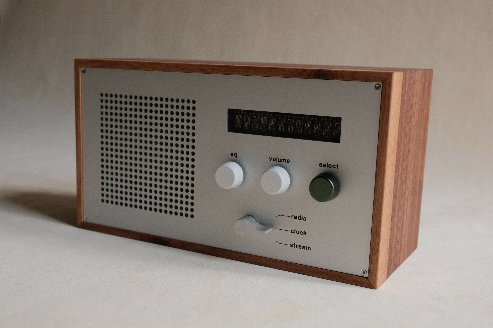

# Cala Radio



A minimal async internet radio player in Rust.

More about the radio at [cala.studio](https://cala.studio).

## Raspberry Pi DietPi Setup

```bash
WIFI_SSID=MyNetwork WIFI_COUNTRY=DE ./dietpi-initial-setup.sh
ssh cala-radio
# follow initial setup instructions
curl -sL https://raw.githubusercontent.com/sonocotta/raspberry-media-center/refs/heads/main/firmware/cloud-init/configure-louder-diet-pi.sh | sudo bash
apt install alsa-utils
# lower digital and analog gain
alsamixer
sudo alsactl store
sudo usermod -aG audio,i2c,gpio dietpi
```

## Build

```bash
curl --proto '=https' --tlsv1.2 -sSf https://sh.rustup.rs | sh
cargo build --release
```

## Run

Place your stations in `radios.txt`. Each line is either a plain URL or `Name,URL`:

```
80s80s,https://regiocast.streamabc.net/regc-80s80smweb2517500-mp3-192-1672667
FluxFM,https://fluxfm.streamabc.net/flx-flxixyvc7dcrphuais-mp3-320-6696362
```

Then run:

```bash
cargo run
```

Or with a custom file:

```bash
cargo run -- my-radios.txt
```

## Streamer / Spotify Connect

Rotate the 8421 mode selector to **Streamer** (position `0x6`) to turn the
radio into a Spotify Connect receiver named **"Cala Radio"**.

- From the Spotify app on your phone (same Wi-Fi network), open **Devices** and
  pick **Cala Radio**. Zeroconf authentication happens automatically — no
  username/password or setup URL is needed on the radio.
- Spotify Connect is **Wi-Fi/LAN only** (no Bluetooth) and requires a
  **Spotify Premium** account.
- The **Select** button toggles play/pause; the **Volume** knob keeps adjusting
  the hardware output while the phone's volume controls the stream's software
  volume.
- Rotating the selector away from Streamer stops the receiver and interrupts
  playback.
- Credentials and (optionally cached) audio are stored under `.cache/`
  (gitignored) on the Pi.

> Requires a build of `librespot`; the `vergen` build-dependency pin in
> `Cargo.toml` works around a bug in the published `librespot 0.8.0`.

## EQ knob

The third knob drives the amplifier's 15-band equalizer, grouped into
**LOWS** (20–125 Hz), **MIDS** (200–1250 Hz) and **HIGHS** (2–16 kHz).

- **Click** to move to the next group, **turn** to raise or lower the selected
  group in 1 dB steps, up to ±6 dB. Either way the display shows the group and
  its setting, e.g. `MIDS +2`, for two seconds.
- The knob shifts a whole group relative to a base curve, so a shape tuned per
  band in `alsamixer` is kept.
- Works in Radio and Streamer mode; the EQ is in the amplifier, so it applies
  to Spotify as well.
- The curve is saved to `eq.txt` in the working directory (`--eq-file` to move
  it) a few seconds after the last change, and restored on start. On the first
  start the amplifier's current curve becomes the base. To re-tune the base:
  stop the radio, adjust the bands in `alsamixer`, delete `eq.txt`, and start
  the radio again.

## Time

The Clock mode shows the local time, set the timezone:

```bash
sudo dietpi-config
# Go to Language/Regional Options → Timezone.
```

## Running as a service

The radio is meant to be left alone, so it runs under systemd rather than
being started by hand. `supervisor.nu` manages the unit; `build.nu` never
touches it.

```bash
nu supervisor.nu install     # copy radio.service to the Pi, enable + start
nu supervisor.nu status
nu supervisor.nu logs --follow
nu supervisor.nu restart     # after deploying a new binary
```

The unit (`radio.service`) restarts on any exit, with no give-up limit, and
uses `Type=notify` with `WatchdogSec=60`. The watchdog matters: `Restart=always`
only catches a process that *dies*, while the ping the panel loop sends every
20 s is what catches one that is alive but wedged.

## Reliability notes

Some behaviour that is deliberate and easy to mistake for a bug:

- **Nothing about a peripheral is fatal.** A missing display, an unresponsive
  knob, or a mode selector whose GPIO lines are still held all degrade to
  "keep playing music", and are retried in the background. Only a total
  failure to open an audio device causes an exit — after a minute of retries,
  so systemd restarts into a fresh attempt.
- **A missing `radios.txt` is not fatal** either; a built-in fallback station
  is used and the reason is logged.
- **Streams reconnect forever** with exponential backoff (1 s to 30 s). The
  display keeps showing the station name; the journal says why it is silent.
- **The audio callback never blocks.** Network data reaches it through a
  bounded ring buffer, and a starved buffer produces silence plus a reconnect,
  never a stalled ALSA callback.
- **The Spotify session is supervised.** A dropped dealer connection, expired
  token, or restarted mDNS responder is rebuilt automatically.

## Test

```bash
cargo test
```

Most of the hardware code is behind `#[cfg(target_os = "linux")]`, so a
host-only `cargo clippy` does not lint it. Lint the real target:

```bash
cross clippy --target aarch64-unknown-linux-gnu --all-targets -- -D warnings
```

Or let the build script do both:

```bash
nu build.nu --release --check
```

## Cross Build

The repo is set up for `cross` (Docker-based cross-compilation) targeting a **Raspberry Pi Zero 2 W** running a 64-bit OS (`aarch64-unknown-linux-gnu`). ALSA is bundled via a custom Docker image so no host-system libraries are required.

### One-time setup

```bash
rustup target add aarch64-unknown-linux-gnu
docker build --platform linux/amd64 -t radio-cross-aarch64 -f Dockerfile.cross-aarch64 .
```

### Build & deploy

```bash
nu build.nu --release --deploy
```

Deploying copies the binary and `radios.txt`. If the service is installed,
restart it:

```bash
nu supervisor.nu restart
```

Or just build locally:

```bash
nu build.nu --release
```

## License

[MIT](LICENSE)
